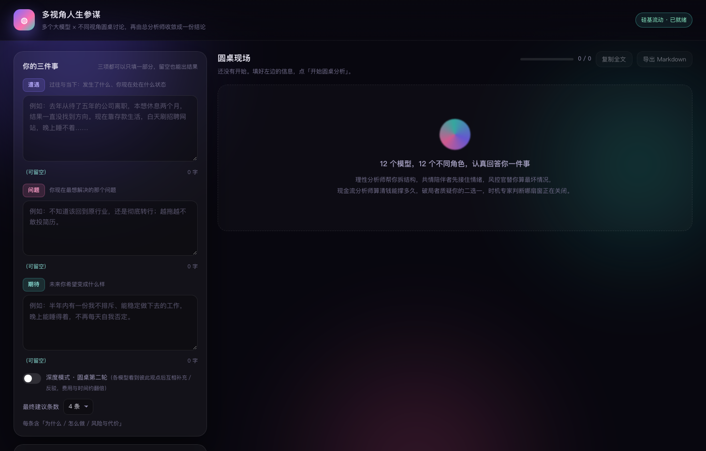

# 多视角人生参谋 · Multi-Perspective Advisor

把一件让你纠结的事，交给 **12 个不同的大模型**，每个模型扮演一个**不同的角色**独立分析，
最后再由一个汇总模型收敛成一份带多视角对照的最终报告。



## 为什么不是「问一个大模型」

同一个问题问五个模型，答案往往高度雷同——它们的训练语料和「安全回答」倾向太接近。
所以这个工具做了两件事：

1. **换厂商**：12 个模型来自 5 个不同厂商（阿里、蚂蚁、智谱、DeepSeek、腾讯），
   训练数据、对齐方式、盲区都不一样。
2. **换立场**：每个模型被指派一个角色，强制从不同方向切入问题——
   理性分析师拆因果链，共情陪伴者先接住情绪，风控官算最坏情况，现金流分析师算钱能撑多久，
   破局者质疑你的「二选一」，时机专家判断哪扇窗正在关闭。

差异化的模型 + 差异化的立场，才会产生真正有信息量的分歧。而分歧，恰恰是这份报告最有价值的部分。

## 它是怎么工作的

```
你输入三件事（遭遇 / 问题 / 期待，每项都可留空）
        ↓
随机抽取 12 个模型 × 12 个角色，12 路并发独立作答
        ↓
汇总模型读取全部 12 份意见，输出最终报告
        ↓
最终报告 = 三者关系分析 + 多模型共识 + 分歧与多视角对照 + 4 条建议 + 最终判断
```

实测（硅基流动，真实调用）：**12 份意见约 27 秒完成，含最终稿总耗时约 55～60 秒，单次花费约 ￥0.03**。

## 快速开始

需要 Python 3（macOS 自带的就够了，**不需要安装任何第三方库**）。

```bash
git clone https://github.com/DYHAI/multi-perspective-advisor.git
cd multi-perspective-advisor

# 首次运行会自动生成 data/config.json
python3 app.py

# 然后把 API Key 填进 data/config.json
# 也可以直接复制模板：cp config.example.json data/config.json
```

macOS 用户也可以直接双击 **`启动.command`**，浏览器会自动打开 `http://127.0.0.1:8765/`。

配置好的 `data/config.json` 关键部分：

```json
{
  "active_provider": "siliconflow",
  "providers": {
    "siliconflow": {
      "api_key": "sk-你的硅基流动Key",
      "base_url": "https://api.siliconflow.cn/v1"
    }
  }
}
```

也支持环境变量（优先级低于配置文件）：`export SILICONFLOW_API_KEY=sk-xxx`。

## 用哪个平台

默认用 **[硅基流动 SiliconFlow](https://cloud.siliconflow.cn)**：一个 Key 就能调用 14 个不同厂商的便宜模型，
支持支付宝/微信充值，国内直连快。模型池里的模型都实测过，单次响应都在 25 秒以内，单价极低。

代码里保留了任何 **OpenAI 兼容接口** 的支持（改 `base_url` 即可）：OpenRouter、阿里云百炼、
火山方舟、DeepSeek 官方等都可以。换平台时记得同时改 `MODEL_POOL` 里的模型 ID。

## 12 个角色

| 角色 | 关注点 |
| --- | --- |
| 理性分析师 | 区分事实/推断/情绪，摊开因果链与关键杠杆 |
| 共情陪伴者 | 先准确说出情绪与未被满足的需要 |
| 现实主义风控官 | 真实约束、最坏情况、不可逆风险、保底方案 |
| 长期战略家 | 3～10 年尺度，可积累的资产与未来选择权 |
| 苏格拉底提问者 | 追问隐藏假设，给出颠覆性替代视角 |
| 行动教练 | 今天/本周/本月能做的具体动作 |
| 系统关系观察者 | 家庭、组织、文化期待等结构性约束 |
| 证据与概率审查者 | 信息质量、概率判断、何时该改变判断 |
| 身心状态顾问 | 睡眠、精力、身体信号是决策的前提条件 |
| 经济与现金流分析师 | 钱能撑多久，用财务红线倒推时间表 |
| 反直觉破局者 | 质疑「二选一」本身，提出第三种可能 |
| 时机与节奏专家 | 什么时候必须动，什么时候可以等 |

## 输入怎么填

三个输入框都可以**只填一部分**，缺失的部分模型会明确标注出来，不会编造：

- 只填「遭遇」不填问题 → 它先帮你判断「这里真正的问题是什么」
- 只填「期待」→ 它反过来推演「要走到这个结果，现在的关键岔路在哪」

## 项目结构

```
multi-perspective-advisor/
├── app.py                 后端：模型调度、SSE 流式转发、角色与提示词定义（零依赖）
├── static/
│   ├── index.html         页面结构
│   ├── style.css          样式
│   └── app.js             前端逻辑：随机抽阵容、流式渲染、Markdown 渲染、导出
├── config.example.json    配置模板
├── 启动.command            macOS 双击启动
└── data/                  运行时生成：config.json（你的 Key）与 history/（分析记录）
```

## 想改点什么

| 想改的东西 | 改哪里 |
| --- | --- |
| 每轮抽几个模型 | `data/config.json` 的 `random_count` |
| 候选模型池 | `app.py` 的 `MODEL_POOL`（含实测耗时与单价） |
| 角色设定 | `app.py` 的 `LENSES`（`style` 字段就是该角色的系统提示词） |
| 最终报告结构 | `app.py` 的 `aggregator_messages()` |
| 单次调用超时 | `data/config.json` 的 `idle_timeout` / `hard_timeout` |

## 踩过的坑（都已在代码里处理）

- **国内直连海外 API 会卡 20 秒**：`openrouter.ai` 走 Cloudflare，IPv6 回程不通，系统优先选 IPv6 就会等到超时。
  程序默认强制 IPv4（实测：强制 IPv4 时 4/4 成功，自动模式 2/4 成功且失败时卡 62～79 秒）。
- **推理模型长时间不输出**：DeepSeek-V3.2 这类模型「思考」阶段没有可见正文，整个汇总要多花两三分钟。
  汇总模型因此换成了实测最快的 Qwen3-30B-A3B-Instruct。
- **流式接口重复上报累计用量**：如果在每个分片里累加 token，费用会被放大上千倍（实测虚高到 ￥4.30）。
  现在按调用去重取最大值。
- **单次请求静默挂起**：没有超时保护时，一个卡住的请求会拖死整批。现在有「空闲 40 秒断开 / 总时长 100 秒截断」。

## 隐私

API Key 只保存在本机 `data/config.json`，分析记录只写在 `data/history/`，
两者都已在 `.gitignore` 中排除，不会进入仓库，也不会上传到任何第三方。

## 可以怎么用它

它不是算命工具，更像一个随时在线的顾问团：职业岔路、感情里的反复内耗、要不要读博、
父母生病与工作的冲突、副业该不该继续——那些你不好意思反复问朋友、又确实需要多个角度的问题。

**它给的不是答案，是一张更清楚的地图。** 决定权始终在你手上。
